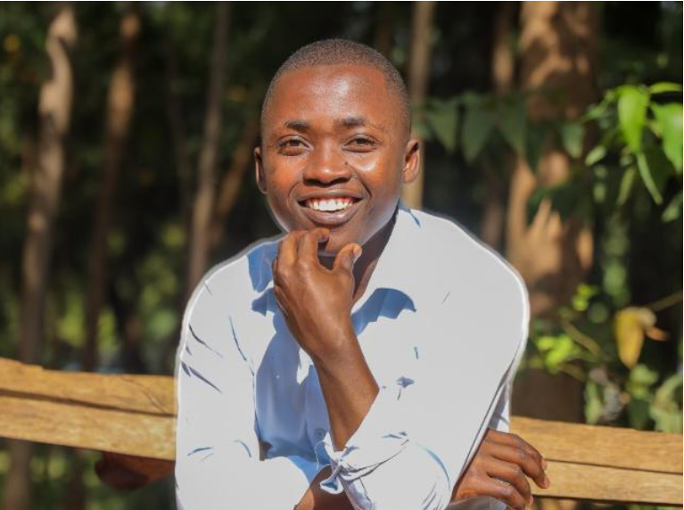

# Accessibility Report

**Page audited:** `index.html` (About Me page)
**Live site:** https://antonyshisia.github.io/iyf-s12-week-01-antonyshisia/
**Author:** Antony Shisia

## Summary

I audited my About Me page against five accessibility checks: image alt text, heading hierarchy, descriptive link text, the `lang` attribute, and form labels. The page already passed all five. The audit also found three smaller issues, which I fixed. The final Lighthouse score is recorded at the end of this report.

---

## 1. Audit checklist (before changes)

| # | Check | Result | Details |
|---|-------|--------|---------|
| 1 | Images have `alt` text | Pass | `alt="Photo of Antony Shisia"` |
| 2 | Heading hierarchy (h1 → h2 → h3) | Pass | One `<h1>`, then an `<h2>`; no levels skipped |
| 3 | Descriptive link text | Pass | "Kenya National Commission on Human Rights" and the email address; no "click here" links |
| 4 | `lang` attribute on `<html>` | Pass | `<html lang="en">` |
| 5 | Form labels linked to inputs | Not applicable | `index.html` has no form. The form on `contact.html` uses `<label for="...">` linked to each input's `id` |

---

## 2. Issues found

| # | Issue | Why it matters |
|---|-------|----------------|
| 1 | No `<main>` landmark around the page content | Screen reader users cannot jump straight to the main content |
| 2 | The intro, favorite website and contact paragraphs had no headings of their own | Screen reader users navigate by headings, so these sections were missing from the page outline |
| 3 | The photo had both `width="400"` and `height="300"` set | If the photo is not 4:3, it is stretched or squashed |

---

## 3. How I fixed them

### Issue 1: Added a `<main>` landmark

**Before**
```html
<body>
    <h1>Antony Shisia</h1>
    ...
</body>
```

**After**
```html
<body>
    <main>
        <h1>Antony Shisia</h1>
        ...
    </main>
</body>
```

### Issue 2: Added headings for each section

**Before**
```html
<p>I am Antony Shisia. ...</p>
...
<p>My favorite website is the <a href="https://www.knchr.org/">Kenya National Commission on Human Rights</a>.</p>
<p>Contact me at <a href="mailto:antonyshioni03@gmail.com">antonyshioni03@gmail.com</a>.</p>
```

**After**
```html
<h2>About Me</h2>
<p>I am Antony Shisia. ...</p>
...
<h2>Favorite Website</h2>
<p>My favorite website is the <a href="https://www.knchr.org/">Kenya National Commission on Human Rights</a>.</p>

<h2>Contact</h2>
<p>Contact me at <a href="mailto:antonyshioni03@gmail.com">antonyshioni03@gmail.com</a>.</p>
```

The heading order is still `h1` → `h2`, with no skipped levels.

### Issue 3: Removed the fixed height on the photo

**Before**
```html

```

**After**
```html

```

With only `width` set, the browser keeps the photo's natural proportions.

---

## 4. Final Lighthouse accessibility score

**Accessibility score: 83 / 100**


**How I ran the audit**
1. Opened the live site in Chrome.
2. Pressed **F12** and opened the **Lighthouse** tab.
3. Ticked **Accessibility** only and clicked **Analyze page load**.

**Screenshot of the result**


---

## 5. Keyboard check

- [x] Pressed **Tab** repeatedly and reached both links
- [x] A visible focus outline showed on each link
- [x] No keyboard traps

---

## 6. Files changed

- `index.html`: added `<main>`, section headings, and removed the photo's fixed height
